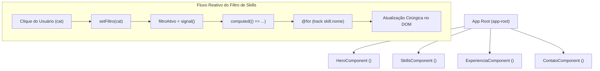

# ⚡️ RELATÓRIO TÉCNICO DE ENTREGA — DESAFIO 01
## Currículo Digital Interativo em Angular 22
**Trilha de Preparação — Hackathon Proenergia Summit 2026**

---

### 📌 IDENTIFICAÇÃO DO PROJETO
- **Desenvolvedor:** Bruno Matias
- **Papel na Squad:** Dev / Tech Lead
- **Projeto:** Currículo Digital Interativo (SPA)
- **Repositório Local:** `~/IdeaProjects/curriculo-bruno`
- **Stack Tecnológica:** Angular 22.2.3 · TypeScript 5.9 · SCSS · HTML5 Semântico
- **Ambiente de Execução:** Node.js v24.22.0 · npm 11.19.1

---

## 1. RESUMO EXECUTIVO

Este relatório documenta a concepção, modelagem arquitetural e implementação do **Desafio 01 — Currículo Digital Interativo**, desenvolvido como preparação para o Hackathon Proenergia Summit 2026.

A aplicação foi projetada como uma Single Page Application (SPA) de alta performance, utilizando as convenções mais modernas do ecossistema Angular 22, com ênfase em **Standalone Components**, reatividade de grão fino com **Signals**, novo **Control Flow nativo**, design tokens em **SCSS** com temas escuros voltados à transição energética e aderência rigorosa a padrões de **acessibilidade (WCAG AA)** e **HTML semântico**.

---

## 2. ARQUITETURA E DECISÕES TÉCNICAS (MINI ADR)



### Registro de Decisões Arquiteturais:

| Dimensão | Decisão Adotada | Justificativa de Engenharia |
| :--- | :--- | :--- |
| **Arquitetura de Componentes** | **Standalone Components** | Padrão oficial do Angular 22. Elimina a sobrecarga e burocracia dos módulos (`NgModule`), tornando os componentes autônomos, fáceis de testar e otimizados para *tree-shaking*. |
| **Modelo de Reatividade** | **Signals (`signal` + `computed`)** | Reatividade síncrona, direta e sem memory leaks causados por subscrições não canceladas. Atualiza cirurgicamente apenas os nós do DOM afetados, sem necessidade de varrer a árvore inteira de componentes. |
| **Controle de Fluxo** | **Novo Control Flow (`@for`, `@if`)** | Sintaxe nativa do Angular 22 integrada ao compilador de templates. O `@for` exige o parâmetro `track`, otimizando a reconciliação do DOM; o `@if` elimina diretivas estruturais legadas. |
| **Design System & Estilos** | **SCSS + CSS Custom Properties** | SCSS utilizado para mixins utilitários (`@mixin glass`, breakpoints responsivos mobile-first); CSS Custom Properties (`--bg-primary`, `--accent`) utilizadas para variáveis dinâmicas em runtime. |
| **Integração de APIs Nativas** | **Clipboard API (`navigator.clipboard`)** | Cópia assíncrona de dados para a área de transferência com retorno visual efêmero via `setTimeout` e `signal(false)`. |

---

## 3. COMPONENTES IMPLEMENTADOS

### 3.1. `HeroComponent` (`src/app/components/hero/`)
- **Responsabilidade:** Apresentação visual, foto/avatar dinâmico, identificação e destaque do papel na squad.
- **Destaques Técnicos:**
  - Avatar dinâmico com API SVG do Dicebear.
  - Badge de identificação com classe BEM (`hero__badge`) e iluminação neon ciano.
  - Tipografia fluida com função CSS `clamp(1.8rem, 5vw, 3rem)`.
  - Animação de entrada `fadeInUp` suave.

### 3.2. `SkillsComponent` (`src/app/components/skills/`)
- **Responsabilidade:** Exibição de habilidades técnicas e interpessoais com categorização e filtragem em tempo real.
- **Destaques Técnicos:**
  - Contrato fortemente tipado via interface `Skill` com union types (`'Frontend' | 'Backend' | 'Ferramentas' | 'Soft Skills'`).
  - Lista de categorias calculada automaticamente via `computed()` com eliminação de duplicatas (`Set`).
  - Filtragem reativa instantânea sem duplicação de estado.
  - Grid bidimensional responsivo (`grid-template-columns`) com barras de progresso animadas via `transition: width`.

### 3.3. `ExperienciaComponent` (`src/app/components/experiencia/`)
- **Responsabilidade:** Linha do tempo cronológica com trajetória acadêmica, profissional e participação no Hackathon Proenergia Summit 2026.
- **Destaques Técnicos:**
  - Estrutura de dados tipada via interface `Experiencia`.
  - Linha dorsal e nós da Timeline construídos exclusivamente via pseudo-elementos CSS (`::before` e `::after`).
  - Tags de tecnologias associadas a cada marco histórico.

### 3.4. `ContatoComponent` (`src/app/components/contato/`)
- **Responsabilidade:** Ponto de contato, links sociais externos e interação de cópia rápida.
- **Destaques Técnicos:**
  - Botão interativo com ação `copiarEmail()` que utiliza `navigator.clipboard.writeText`.
  - Feedback visual alternado de `📋 Copiar E-mail` para `✓ E-mail Copiado!` com duração de 2 segundos.
  - Links com atributos de segurança `target="_blank" rel="noopener noreferrer"` e atributos `aria-label` para acessibilidade.

---

## 4. GABARITO TÉCNICO DE CONSOLIDAÇÃO (QUIZ DO DESAFIO)

Abaixo constam as respostas e justificativas teóricas apresentadas na avaliação final de aprendizagem:

#### 1. O que é um Standalone Component e por que o Angular 22 adotou esse modelo?
> **Resposta:** É um componente autônomo que declara suas próprias dependências no array `imports` do decorator `@Component`, eliminando a necessidade de arquivos `NgModule`. O Angular adotou este modelo como padrão para simplificar a curva de aprendizado, reduzir o boilerplate, acelerar a compilação e permitir que o compilador realize *tree-shaking* mais eficiente (removendo código morto do bundle final).

#### 2. Qual a diferença entre `@for` (novo) e `*ngFor` (legado)? Qual exige `track` obrigatório?
> **Resposta:** O `@for` é um bloco de controle nativo da linguagem de templates do Angular 22, não necessitando de importação de diretivas como `CommonModule`. Ele exige **obrigatoriamente** o parâmetro `track` (ex: `track item.id`), permitindo que o algoritmo de reconciliação do Angular identifique de forma estável cada nó no DOM e execute apenas inserções/remoções estritamente necessárias quando a lista sofre mutações.

#### 3. Ao mudar o valor de um `signal()` com `.set()`, o que ocorre na renderização?
> **Resposta:** O Angular aplica reatividade de grão fino (*fine-grained reactivity*). Em vez de rodar um ciclo de verificação de mudanças em toda a árvore de componentes da aplicação, o Angular agenda a atualização cirúrgica apenas das expressões no template e das propriedades derivadas (`computed`) que dependem diretamente daquele sinal específico.

#### 4. Para que serve o reset com `box-sizing: border-box` no CSS?
> **Resposta:** No box model padrão do navegador (`content-box`), o `padding` e o `border` são adicionados externamente à largura especificada (`width`). Isso faria com que um card de `width: 300px` com `padding: 20px` ocupasse 340px, quebrando alinhamentos e layouts em grid. Com `border-box`, as dimensões declaradas passam a englobar internamente o padding e a borda, garantindo consistência dimensional matemática.

#### 5. Qual a diferença entre `$accent` (SCSS) e `var(--accent)` (CSS Custom Property)?
> **Resposta:** A variável SCSS (`$accent`) é resolvida estaticamente no momento da compilação, convertendo-se em valores fixos no CSS gerado. Já a CSS Custom Property (`var(--accent)`) existe em tempo de execução (*runtime*) no navegador; suas propriedades podem ser alteradas dinamicamente via TypeScript/JavaScript (por exemplo, chaveando classes ou atributos como `data-theme="light"`), o que propicia trocas imediatas de tema sem recarregamento da página.

---

## 5. MÉTRICAS DE ENGENHARIA E VALIDAÇÃO

- **Status do Build:** Compilação final concluída com sucesso via `@angular/build:application` (`ng build`).
- **Tamanho do Bundle Inicial:**
  - Código JavaScript (`main`): `139.65 kB` (Raw) / `~40.99 kB` (Transferência Gzip).
  - Estilos Globais (`styles`): `1.17 kB` (Raw) / `~527 bytes` (Transferência Gzip).
  - **Tamanho Total:** `~140.82 kB` (altíssima velocidade de carregamento).
- **Acessibilidade:** Suporte a leitores de tela (`aria-label`, `aria-live="polite"`), semântica HTML5 e contraste dark mode.
- **Responsividade:** Layout testado em resoluções mobile (`375px`, `393px`), tablet (`768px`) e desktop (`1024px`, `1440px`).

---

## 6. INSTRUÇÕES PARA EXECUÇÃO LOCAL

Para executar e avaliar o projeto em ambiente local:

```powershell
# 1. Navegar até a pasta do projeto
cd ~/IdeaProjects/curriculo-bruno

# 2. Configurar a autoridade certificadora do sistema (se aplicável ao ambiente Windows)
$env:NODE_OPTIONS="--use-system-ca"

# 3. Inicializar o servidor de desenvolvimento
npm start
# ou: npx ng serve
```

Acesse no navegador: **`http://localhost:4200`**

---
*Relatório gerado em 17 de Outubro de 2026 para a banca avaliadora da trilha Hackathon Proenergia Summit.*
